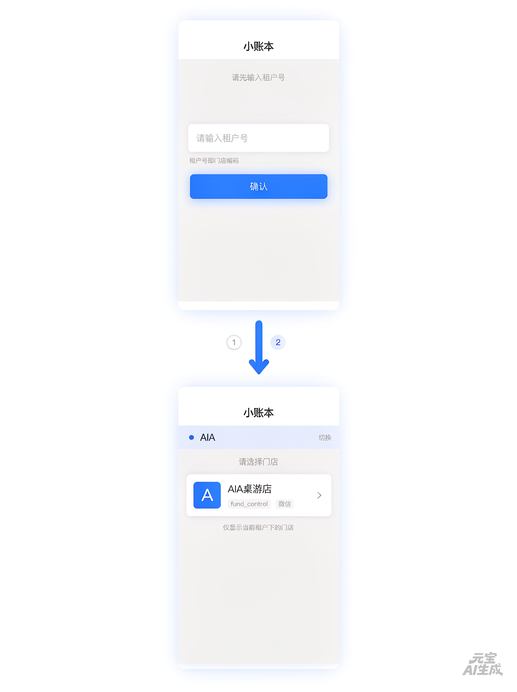
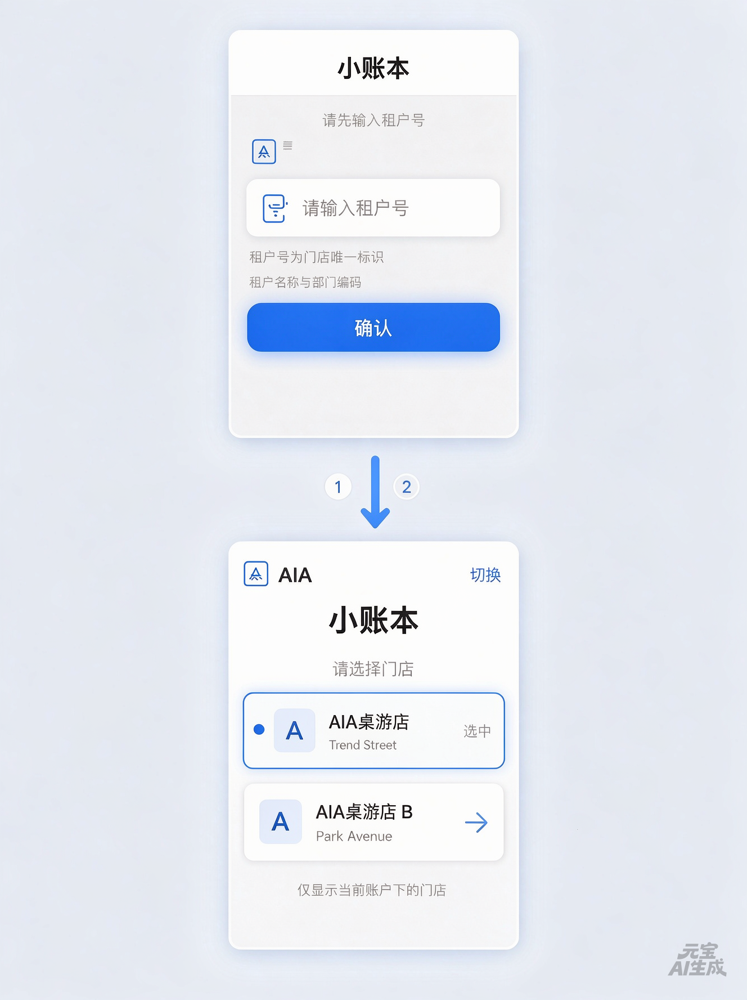
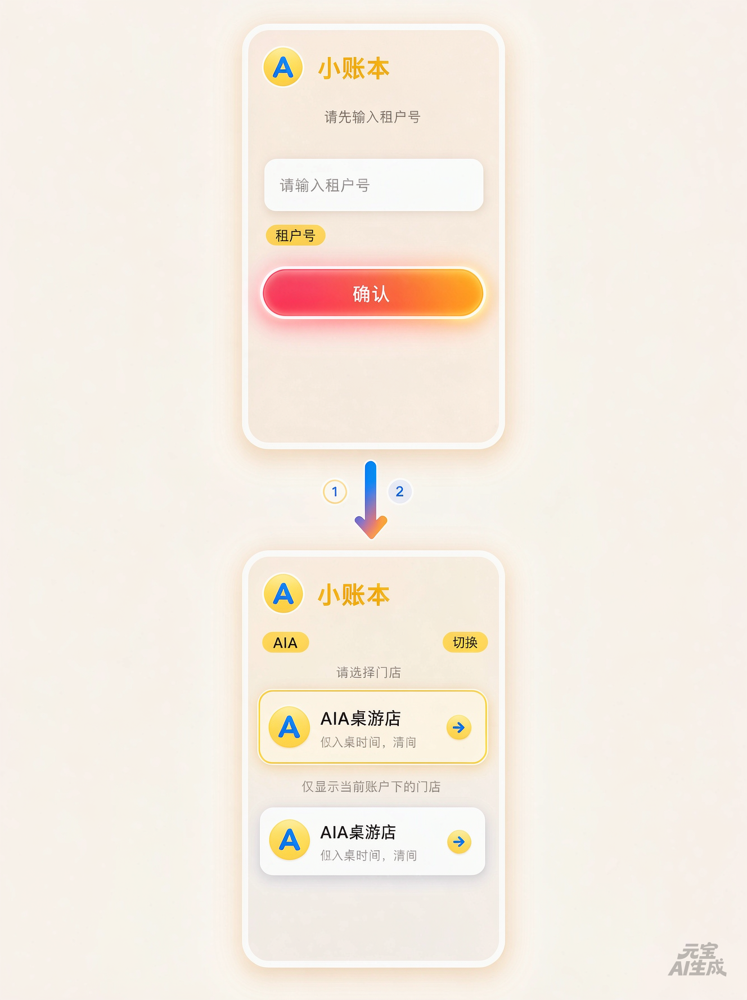
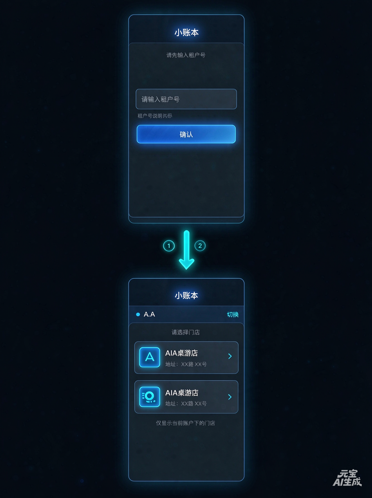
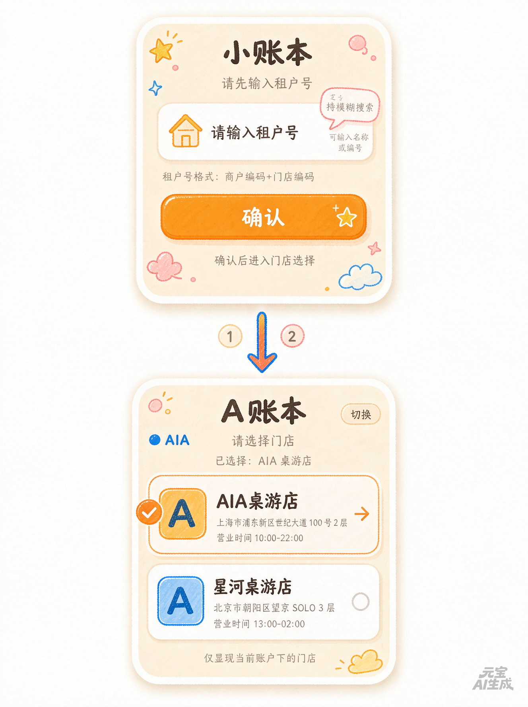

# 小微版功能需求文档
**V3.9（最终版）**

版本日期：2026-10-12

文档状态：当前全部功能需求的最终基线，所有历史版本中与之冲突的表述均以本文档为准。本文档仅描述业务需求，不含技术实现细节。后续新增或变更在此版本上迭代。

## 目录
打开文档时按 F9 或右键“更新域”以刷新目录

# 一、核心业务模型
## 1. 房间与位置
每个房间可设置“有无位置”两种状态：

- 无位置：不启用选座，参与者按人数参与（适用于买菜、自由力量区、散客拼场等）。
- 有位置：启用选座功能，Boss 在背景图上配置具体座位布局。

房间绑定租户，租户有行业描述，系统根据行业判断是否需要排位置。

## 2. 选座交互

- 空闲座位：显示座位号 + 加号标识。
- 已占座位：显示占座人头像 + 小字座位号。
- 点击头像：仅显示该用户姓名。
- 活动锁定后：所有座位变为只读，不可操作。
- 不使用颜色区分状态，用图标和文字表达。

## 3. 图片配置

- 房间背景图：创建房间时上传（房间级），用于 Boss 配置座位布局。
- 活动海报：创建活动时上传（活动级），用于顾客端活动展示。
- 海报支持上传 1~6 张，最少 1 张，最多 6 张。
- 手机端查看海报时支持左右横滑切换，底部显示当前第几张 / 共几张。
- 第一张为封面，活动列表中展示封面。
- PC / Boss 端以缩略图横向排列展示，可点击切换。

## 4. 项目名称与活动名称

- 项目名称：选填，可留空。
- 活动名称：系统按规则自动生成，Boss 可修改。

## 5. 时间字段
全系统时间统一精确到秒（年-月-日 时:分:秒），手机端、PC 端、Boss 端三端一致。

# 二、账号体系与登录
## 1. 账号层级
平台只管理到“租户”这一层，不碰租户内部角色。账号层级如下：

| **层级** | **角色** | **由谁创建** | **说明** |
| --- | --- | --- | --- |
| 平台层 | 租户 Admin | 平台 Admin | 平台创建租户时一并创建租户 Admin 账号 |
| 租户层 | Boss（老板） | 租户 Admin | 租户 Admin 在内部创建 Boss 账号 |
| 租户层 | 员工（司机/导游/助教） | 租户 Admin 或 Boss | 内部代建并分发凭证 |
| 租户层 | 顾客 | 租户 Admin 或 Boss | 内部代建并分发凭证 |
平台 Admin 只负责创建租户、分配租户号、创建租户 Admin 账号，不负责租户内部的 Boss / 员工 / 顾客账号。

## 2. 租户 Admin 首次登录

- 平台线下提供：租户号 + 租户 Admin 用户名密码。
- 租户 Admin 首次打开系统 → 输入租户号 → 确认（系统记住租户号）。
- 输入租户 Admin 凭证 → 登录。
- 后续打开直接到登录页，无需重填租户号。
- 提供“切换租户”入口（需重新输入租户号）。
- 登录后可创建 Boss、员工、顾客账号。

**手机端登录（小账本 App）**

登录界面统一采用「小账本」系统名（顶部固定标题）与租户名（如 AIA，由租户号查回后展示在门店选择区）分层展示的方式，二者不混淆：小账本为系统名称，AIA 为租户名称。

*图：Boss 手机端登录流程（输入租户号 → 选择门店 → 输入凭证登录）*

**图：Boss 手机端登录流程 · 四种主题风格对比（原图 + 主题 1~4）**

| **原图（当前线上版）**   | **主题 1　清新简约风**   | **主题 2　活力渐变风**   |
| --- | --- | --- |
| **主题 3　暗黑科技风**   | **主题 4　温暖手绘风**   | 说明：五张图页面结构、元素位置与全部中文文案完全一致，仅配色、圆角、图标风格与动效氛围不同，供 UI 评审选型。 |

| **角色** | **入口方式** | **是否输入租户号** | **是否选择门店** |
| --- | --- | --- | --- |
| Boss | 手动输入租户号 | 是 | 是 |
| 员工 | 扫码（二维码内含租户 ID） | 否，自动带入 | 否，直接登录 |
| 顾客 | 扫码（二维码内含租户 ID） | 否，自动带入 | 否，直接登录 |
**Boss 手机端登录（手动选租户）：**

Boss 在手机端无预置租户信息，首次登录需手动输入平台提供的租户号并确认，系统据此拉取该租户下的门店列表；在门店列表中点选目标门店卡片（需主动点击，不做自动跳转），进入该门店登录页输入 Boss 凭证完成登录。后续打开手机端直接进入登录页，无需重填租户号；如需切换租户，可通过「切换租户」入口重新输入租户号。

**员工 / 顾客手机端登录（扫码带租户）：**

员工与顾客的账号由租户 Admin 或 Boss 创建并生成带租户 ID 的二维码，扫码后系统自动识别租户及所属门店，直接跳转登录页，无需手动输入租户号、也无需再次选择门店，输入账号凭证即可登录。

## 4. 角色与权限

| **角色** | **能力** |
| --- | --- |
| 租户 Admin | 全权管理（建 Boss / 员工 / 顾客、配置租户级功能开关、管理行业功能开关） |
| Boss | 由租户 Admin 授权，通常包含编排座位、解锁活动、建活动、配置布局等 |
| 员工 / 导游 / 司机 | 登录查看分配的活动和座位，不可自行换座 |
| 顾客 | 登录、选择空闲座位、查看自己信息、取消自己的座位 |
| 平台 Admin | 创建租户、分配租户号、创建租户 Admin、配置行业级功能开关 |
# 三、位置布局配置
## 1. 拖拽定位（Boss PC 端）

- Boss 上传背景图后，输入座位数量，系统生成对应数量的可拖拽标记点。
- Boss 从点池中将标记点拖拽到背景图上对应位置。
- 已放置的点支持：拖拽微调位置、点击删除退回点池、双击修改编号或备注。
- 保存后坐标生效，手机端按位置渲染座位。
- 此方案适用于所有物理布局（车厢过道、弧形排列、不规则座位等）。

## 2. 复制布局（Boss 专属）

- 从已有房间复制：选择一个已配置好的房间，一键带入其背景图和全部座位坐标。
- 存为模板：将配置好的布局命名保存为模板，后续新建房间直接选用。
- 复制后可微调（增删座位、改坐标、换背景图、改编号）。
- 仅 Boss 可使用此功能。

## 3. 默认房间模板

- 平台 Admin 在创建行业时可添加该行业下的默认房间模板。
- 每个模板包含：模板名称 + 默认背景图（简洁线条示意图，非真实照片）。
- Boss 创建房间时选择行业后，系统列出该行业下的模板供选择。
- 选模板自动带入默认图，Boss 可直接使用或点击“更换图片”上传自己的图。

## 4. 背景图上传限制

| **项目** | **限制** |
| --- | --- |
| 格式 | 仅支持 JPG、PNG、WebP |
| 大小 | 不超过 2MB |
| 最大尺寸 | 1920 × 1080 像素 |
| 不合规处理 | 拒绝上传并提示原因 |
| 加工方式 | Boss 自传的图片原样存储和展示，不做滤镜、蒙版等加工 |
| 内容审核 | 系统不审核图片内容 |
## 5. 座位标记显示

- PC 端标记点直径 32 像素，手机端 40 像素（方便手指点击）。
- 空闲：蓝色圆点 + 座位号 + 加号。
- 已占：绿色头像 / 姓名首字 + 小字座位号。
- 预置人员（导游 / 司机）：橙色标记区分。
- 拖拽中：放大显示 + 阴影反馈。

# 四、主题与背景图联动
## 1. 主题色

- 系统提供四种主题色：A 蓝、B 红、C 绿、D 待定。
- Boss 和顾客看到一致的主题色。
- 主题色归属按已有功能逻辑控制。

## 2. 默认图联动

- 默认图为透明底线条图，选择主题后容器填充对应主题色。
- 使用默认图时，背景色、座位标记、按钮高亮均跟随主题色。
- 预置人员标记固定为橙色，不跟随主题。
- Boss 自传背景图时不联动主题色，原图展示。

# 五、人员编排与座位调整
## 1. 活动创建后、锁定前

- Boss 可从员工 / 导游 / 助教 / 司机列表中选择人员，安排到指定座位。
- Boss 可拖拽移动任何已占座位上的人（包括预置人员和顾客）。
- 支持两人互换位置。

## 2. 活动锁定后

- 所有座位变为只读，不可添加人员或移动。
- Boss 如需调整，必须先解锁活动。
- 解锁时弹出二次确认提示：“解锁后座位可调整，确定解锁吗？”。
- 确认后解锁，解锁后可进行调整，调完后 Boss 可再次锁定。

## 3. 权限

| **角色** | **加人** | **移动自己** | **移动别人** | **解锁活动** |
| --- | --- | --- | --- | --- |
| Boss | ✅ | ✅ | ✅ | ✅ |
| 员工 / 导游 / 司机 | ❌ | ❌ | ❌ | ❌ |
| 顾客 | ❌ | ✅（自己的） | ❌ | ❌ |
## 4. 操作日志
所有编排动作必须记录操作日志，包括：添加人员、移动座位、互换位置、锁定、解锁、复制布局。日志用于操作审计，正常操作不触发异常。

# 六、活动打卡（员工专属）
## 1. 功能定位
打卡为轻量级辅助功能，用于记录员工到岗的时间和地点。固定场所（办公室、大巴、房间等）建议 Boss 自行采购实体打卡器，员工到岗刷卡即完成打卡，时间和地点由打卡器自动记录，无需依赖手机。手机 H5 打卡仅作为无打卡器时的轻量兜底，不做复杂定位校验。

## 2. 功能开关链路（与语音开关同构）

| **层级** | **开关** | **说明** |
| --- | --- | --- |
| 平台 Admin（行业级） | 行业是否支持打卡 | 该行业下所有租户可配置打卡 |
| 租户 Admin（租户级） | 本租户是否启用打卡 | 平台开了行业支持，租户才可见 |
| Boss（活动级） | 建活动时配置打卡规则 | 租户开了，活动里才出现打卡设置 |
平台 Admin 关闭打卡 → 该行业所有租户不可见打卡功能。租户 Admin 关闭打卡 → 员工端不显示打卡入口。租户 Admin 开启打卡 → Boss 建活动时可配置打卡规则。

## 3. 打卡方式

- 实体打卡器（主推，Boss 自行采购）：办公室、大巴、房间等固定场所安装一台打卡器，员工到岗刷卡 / 刷脸 / 指纹，打卡器自动记录打卡时间和设备所在位置，无需依赖手机，无持续费用。
- 手机 H5 打卡（兜底）：无打卡器时的备选方案，轻量实现——拍照 + 记录时间 + 记录地点，不依赖地图 API，不产生额外费用。

## 4. 打卡与活动状态的关系
打卡与活动是否锁定无关。活动锁定冻结的是座位编排，不影响员工打卡。活动开始前、进行中，员工均可打卡。打卡记录的核心价值是记录“人什么时候到、在什么位置”，迟到人员更要能打卡以留下迟到记录。是否迟到由打卡时间与活动开始时间比对得出。

## 5. 适用角色
仅员工（司机 / 导游 / DM / 助教）需要打卡；顾客、Boss 不需要打卡。

## 6. H5 打卡规则（兜底方式）

- 员工入口：“我参与的活动” → 点击活动 → 打卡按钮。打卡按钮不受活动锁定影响，锁定后依然可点。打卡记录打卡时间、打卡地点名称、现场照片（照片叠加水印：时间 / 位置 / 用户名）。打卡后系统比对打卡时间与活动开始时间，判断是否迟到并标记。

## 7. Boss 管理

- Boss 在活动管理页查看所有员工打卡记录（时间、地点、照片、是否迟到异常），支持补录打卡（员工忘打时）与导出打卡记录。打卡相关操作记录审计日志。

# 七、公网访问地址

| **端** | **地址** |
| --- | --- |
| 手机 H5 | https://xiaozhangben.com.cn/h5/#/ |
| PC / Boss | https://www.xiaozhangben.com.cn/#/ |
域名已启用。

# 八、已知缺陷（V3.7 上线后待修复）

| **#** | **问题** | **说明** |
| --- | --- | --- |
| 1 | 手机端头像 / 活动图 / 语音不可见不可播 | 疑似 OSS 存储未同步生产环境 |
| 2 | Boss 活动设置看不到顾客预约的活动 | 需按来源聚合展示 |
| 3 | 活动时间仅精确到年月日 | 需精确到分钟，三端统一 |
# 九、安全合规与平台监管
## 1. 租户 Admin 合规协议签署

- 租户 Admin 首次打开系统时，强制弹出合规协议页面，无法跳过。
- 协议内容由平台方提供，涵盖：不涉及违法宣传、不发布违规活动、活动安全责任自负、平台有权停止违规活动和租户。
- 必须勾选“已阅读并同意”并点击确认，否则无法进入系统。
- 签署记录永久留存：签署人、租户号、签署时间、IP、协议版本号。
- 协议版本更新后，仅对新创建租户生效；旧租户已签署的版本维持不变，无需重新签署。

## 2. 顾客端投诉（入口：「我的」页面，分两路）
顾客登录后，在「我的」页面中找到「投诉 / 反馈」入口，提交时须先选择投诉渠道，分两路。

**渠道一：投诉给 Boss（门店内部事务）**

受理范围：活动中涉及“人”的问题——服务态度差、迟到早退、安排不合理、设施损坏、打人骂人、偷东西等，以及消费争议。

上述情况平台不介入，由门店 Boss 在「异常处理」模块中接收、处理与回复。涉及违法犯罪的建议用户直接报警。

提交方式：选择关联活动（必选）→ 选择「投诉给 Boss」→ 填写投诉内容（文字）→ 可选上传图片（最多 3 张，允许从相册选择）→ 提交。

无额外校验门槛，直接提交。

**渠道二：投诉给平台 Admin（活动内容的违法违规）**

受理范围：仅限活动在系统中发布 / 挂载的可查证素材，平台 Admin 可直接查看原文核实。包括但不限于：

- 活动海报（图片）

- 活动宣传音频 / 视频

- 活动文字描述、规则说明

- 活动名称、标签、分类

- 活动页面上挂出的任何宣传素材

**提交要求：**

- 关联活动：必选，从参与过的活动列表中选择；投诉必须针对该活动上挂载的具体内容

- 投诉类别：必选（黄赌毒 / 违法宣传 / 违规活动 / 其他违法乱纪）

- 文字描述：必填，最少 20 字，须说明活动内容中具体哪一处违规

- 取证照片：至少 1 张，调用手机摄像头现场拍摄，不允许从相册选择；照片内容应能体现活动违规素材（如海报截图、活动现场挂出的宣传品、门牌号、车牌号等）

- 无拍照取证则提交按钮不可用

平台不受理的情况：活动中个人之间的言语冲突、辱骂、打架斗殴、盗窃、人身伤害，以及其他任何需要执法部门介入的事件。此类情况请投诉给 Boss 或直接报警。

流向：直达平台 Admin 内部消息中心，由平台介入监管处理。

两条渠道共用同一份投诉记录字段：投诉人（匿名可选）、所属租户、关联活动、投诉渠道（Boss / 平台）、投诉内容、取证照片、提交时间。

## 3. 平台 Admin 监管能力

- 消息中心：查看所有投诉，支持按时间 / 租户 / 活动筛选。
- 活动详情查看：点击投诉涉及的活动，查看完整信息（海报、时间、参与人员、创建人、创建时间）。
- 操作留痕查询：该租户下所有活动的创建、修改、锁定、解锁、人员编排等操作日志。
- 停止活动：将某个活动置为“已停止”状态，顾客端不再展示。
- 停止租户：暂停整个租户，所有账号（Boss、员工、顾客）均无法登录。

## 4. 停止租户后的登录与恢复

- Boss / 其他账号：登录时提示“账号已被暂停，请联系平台管理员”，无其他入口。
- 租户 Admin：登录时提示 license 已暂停，页面仅保留“更新 license”入口，其余功能全部隐藏。
- 租户 Admin 输入平台发放的新 license 码 → 验证通过 → 系统强制跳转至登录页要求重新登录。
- 重新登录时的协议检查：
- 版本不同（协议已更新）：强制弹出新协议，必须签署后才能进入系统。
- 版本相同（协议未变）：直接登录，无需重签。
- 不存在“拿新 license 跳过签协议”的漏洞，每次重新登录必经协议版本比对。

## 5. 平台 Admin 自身操作的审计
平台 Admin 的停止活动、停止租户、发放新 license 等操作本身也必须留审计日志。

## 6. 活动留痕要求（强制）

- 所有租户创建的活动必须留痕，平台 Admin 可查询。
- 留痕内容：活动基本信息、状态变更记录、参与人员列表、关联投诉记录。
- 留痕数据租户不可删除，仅平台 Admin 可管理。

数据保留策略：活动结束后至少保留，具体时长由平台方定。

