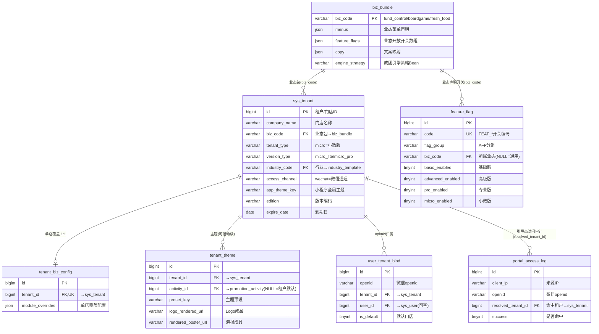
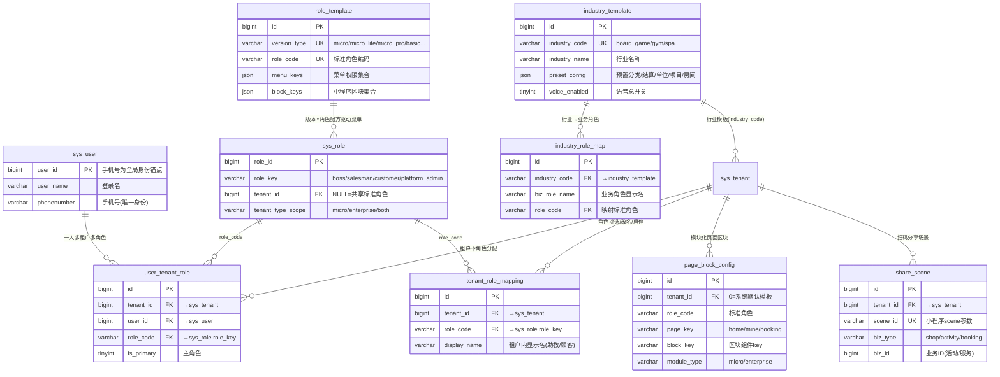
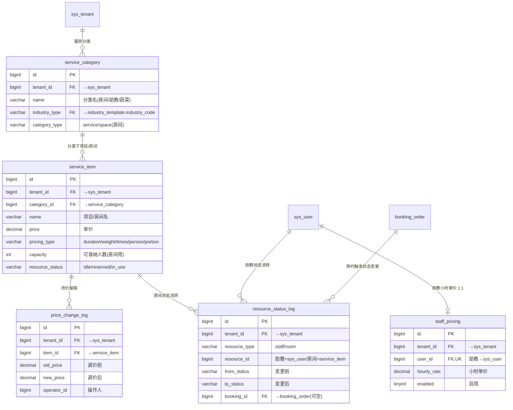
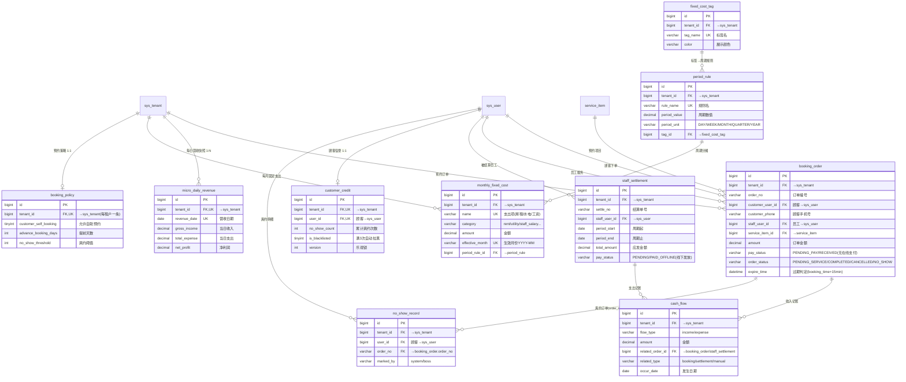
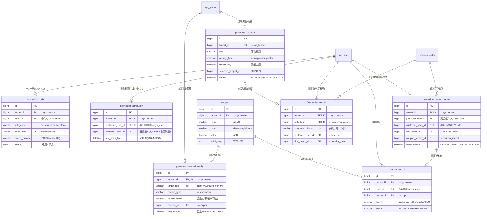
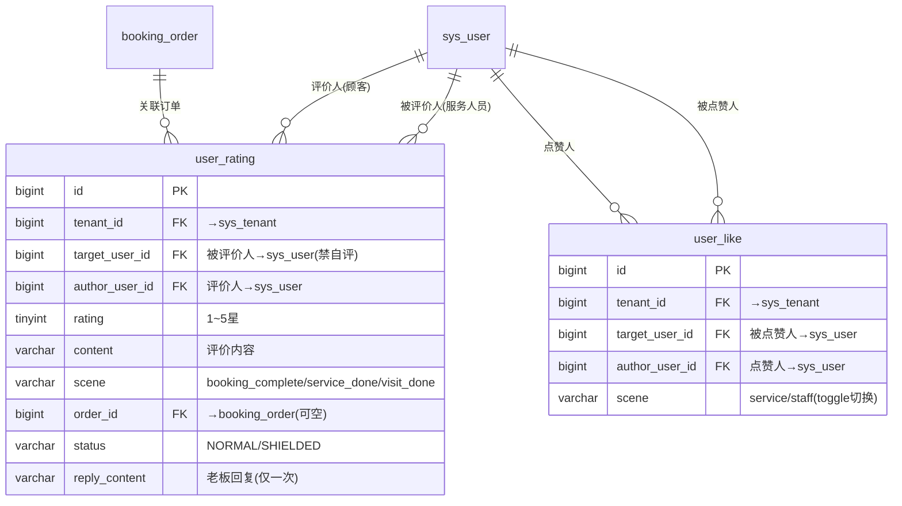
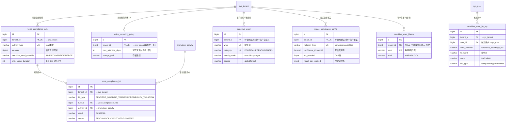

# 资金管控系统 · 小微版（MICRO）实体关系图（ER 图）

> 版本：v1.0　日期：2026-10-10
> 依据：`小微版/sql/00_执行顺序.sql`（v1.76）、`系统管理/sql/00_执行顺序.sql`（v1.32）、
> 《资金管控系统开发任务文档（小微版）》《资金管控系统开发任务文档（系统管理）》及各 `M*` 建表脚本。
> 范围：**小微版部署单元所涉及的全部数据表**（含平台底座共享表 + 小微版专属增量表），每张表为一个实体。

---

## 一、阅读约定

1. **实体命名**：直接使用数据库表名（Mermaid `erDiagram`）。
2. **属性取舍**：仅保留 **主键（PK）/ 外键（FK）/ 核心业务字段**；
   通用审计列 `create_by / create_time / update_by / update_time / del_flag / remark / create_dept` 一律省略，不再逐一画出。
3. **关联类型**：
   - `||--o{` 一对多（1:N）
   - `||--||` 一对一（1:1）
   - `}o--o{` 多对多（逻辑关联）
4. **外键说明**：本项目为 **逻辑外键**（无数据库级 `FOREIGN KEY` 约束），关联通过 `tenant_id / user_id / *_id / order_no` 等列在应用层维护；多租户由 MyBatis-Plus 插件按 `tenant_id` 自动隔离。
5. **表分层**：
   - 【系统级】无 `tenant_id`，全租户共享（须入 `MybatisPlusConfig.IGNORE_TENANT_TABLES`）。
   - 【租户级】含 `tenant_id`，租户间数据隔离。
   - 【混合级】`tenant_id=0` 或 `NULL` 表示平台级记录，非 0 表示租户自定义。
6. **两个核心锚点实体**：
   - `sys_tenant`（租户/门店，`id` 为主键）——几乎所有租户级表通过 `tenant_id` 归属其下。
   - `sys_user`（若依原生用户，`user_id` 为主键，**手机号为全局身份锚点**）——所有 `*_user_id` 逻辑指向它。

---

## 二、全景总览（域间关系）

> 下图省略字段，仅展示 **8 大业务域** 围绕 `sys_tenant` / `sys_user` 两大锚点的归属关系，细节见后续分域图。

```mermaid
erDiagram
    sys_tenant ||--o{ IDENT_ROLE   : "身份·角色·行业·页面"
    sys_tenant ||--o{ SERVICE      : "服务·定价·资源"
    sys_tenant ||--o{ BOOKING      : "预约·结算·现金流·固定支出"
    sys_tenant ||--o{ PROMOTION    : "推广分销·激励·优惠券"
    sys_tenant ||--o{ RATING       : "评价·点赞"
    sys_tenant ||--o{ COMPLIANCE   : "语音·敏感词·图片合规"
    sys_tenant ||--o{ BILLING      : "商业化计费·License·审计"
    sys_tenant ||--o{ PLATFORM     : "平台底座·多租户"

    sys_user   ||--o{ IDENT_ROLE   : "用户身份"
    sys_user   ||--o{ BOOKING      : "顾客/员工"
    sys_user   ||--o{ PROMOTION    : "推广人/被拉新人"
    sys_user   ||--o{ RATING       : "评价人/被评价人"

    PLATFORM {
        bigint id PK "占位-见域1"
    }
    IDENT_ROLE {
        bigint id PK "占位-见域2"
    }
    SERVICE {
        bigint id PK "占位-见域3"
    }
    BOOKING {
        bigint id PK "占位-见域4"
    }
    PROMOTION {
        bigint id PK "占位-见域5"
    }
    RATING {
        bigint id PK "占位-见域6"
    }
    COMPLIANCE {
        bigint id PK "占位-见域7"
    }
    BILLING {
        bigint id PK "占位-见域8"
    }
```

---

## 三、域 1 · 平台底座与多租户（M1_05 / M1_06 / M8）

**说明**：`biz_bundle / feature_flag` 为【系统级】共享表；`tenant_biz_config / tenant_theme / user_tenant_bind` 为【租户级】；`portal_access_log` 为【系统级】仅追加审计表。三维能力模型：`有效功能 = feature_flag(edition) ∩ biz_bundle.feature_flags ∩ License`。

---

## 四、域 2 · 身份 · 角色 · 行业模板 · 页面（M15_01 / M15_02 / M15_03）

**说明**：`role_template / industry_template / industry_role_map` 为【系统级】共享表（无 `tenant_id`）；`user_tenant_role / tenant_role_mapping / page_block_config / share_scene` 为【租户级】。手机号即身份：一个手机号 = 一个 `sys_user`，`user_tenant_role` 支持「一人多租户、一租户多角色」。

---

## 五、域 3 · 服务 · 定价 · 资源（M15_04 / M21_02 / M21_03）

**说明**：全部为【租户级】表。房间 = `category_type=space` 分类下的 `service_item`（零新表）；助教价格用 `staff_pricing`，房间价格复用 `service_item.price`。资源三态：`idle → reserved → in_use → idle`。

---

## 六、域 4 · 预约 · 结算 · 现金流 · 固定支出（M15_05 / M15_13 / M15_21 / M18_02 / M18_03）

**说明**：全部为【租户级】表。V1 零支付合规——`booking_order.pay_status` 仅 `PENDING_PAY/RECEIVED`，`staff_settlement.pay_status` 仅 `PENDING/PAID_OFFLINE`，全系统无在线支付/分账打款，`cash_flow` 为纯记账口径。防爽约仅 `micro_pro` 生效。盈亏公式：`本月盈利 = 本月收入 − (流水支出 + Σ本月固定支出)`。

---

## 七、域 5 · 推广分销 · 激励 · 优惠券（M15_11 / M16 / M18_04）

**说明**：全部为【租户级】表。仅小微版启用（功能开关 `FEAT_PROMOTION_DISTRIBUTION`）。核心规则：一人一码永久有效；归因「谁最后扫码业绩归谁」，交接前锁定不回溯；拉新奖励同一被拉新顾客仅触发一次（`uk_tenant_customer`）；首单以「手机号 + 活动」独立判断，与推广归属解耦。

---

## 八、域 6 · 评价 · 点赞（M17_01）

**说明**：【租户级】表，仅 `micro_pro` 启用（功能开关 `FEAT_RATING`）。防重唯一键：`user_rating(tenant_id,target_user_id,author_user_id,scene,order_id)`、`user_like(tenant_id,target_user_id,author_user_id,scene)`；`SHIELDED` 评价不计入综合评分。

---

## 九、域 7 · 合规（语音 / 敏感词 / 图片）（M18_01 / M18_10）

**说明**：`sensitive_word / sensitive_word_hit_log / image_compliance_config` 为【混合级】（`tenant_id=0` 全局底库，走条件查询而非白名单）；`voice_*` 三表为【租户级】；`sensitive_word_library` 为 M18_01 旧表，M18_11 已幂等迁移至 `sensitive_word`（保留兼容）。敏感词引擎三路共用（文本 / 语音 ASR / 图片 OCR），由 `FEAT_SENSITIVE_WORD / FEAT_IMAGE_COMPLIANCE` 开关控制。

---

## 十、域 8 · 商业化计费 · License · 审计（M14 / M3_05 / M18_06 / M18_07）

```mermaid
erDiagram
    sys_billing_plan ||--o{ sys_billing_order : "套餐→订单"
    sys_tenant ||--o{ sys_billing_order       : "租户计费订单"
    sys_billing_order ||--o| sys_license      : "签发License"
    sys_tenant ||--o| sys_virtual_account     : "虚拟账户 1:1"
    sys_tenant ||--o| sys_profit_sharing_rule : "分账规则 1:1"
    sys_billing_order ||--o{ sys_profit_sharing_record : "订单分账"
    sys_tenant ||--o{ sys_withdrawal_request  : "提现申请"
    sys_tenant ||--o{ sys_settlement_bill     : "结算对账单"
    sys_tenant ||--o{ sys_subscribe_quota     : "订阅消息配额"
    sys_agreement_version ||--o{ sys_user_agreement_log : "协议留痕"
    sys_user ||--o{ sys_user_agreement_log    : "同意用户"
    sys_user ||--o{ sys_account_action_log    : "账户操作留痕"
    sys_license_template ||--o{ sys_license   : "模板→签发"
    sys_tenant ||--o{ sys_license             : "租户License"

    sys_billing_plan {
        varchar plan_code PK "trial/first_month/monthly/yearly"
        decimal price "价格"
        int     days "有效天数"
        varchar license_type "TRIAL/FORMAL"
        varchar version_type "分档(小微版)"
    }
    sys_billing_order {
        bigint  id PK
        varchar order_no UK "订单号"
        bigint  tenant_id FK "→sys_tenant"
        varchar plan_code FK "→sys_billing_plan"
        decimal amount "金额"
        varchar license_id FK "→sys_license"
        varchar pay_status "PENDING/PAID/REFUNDED/CANCELLED"
    }
    sys_virtual_account {
        bigint  id PK
        bigint  tenant_id FK,UK "→sys_tenant(每租户一个)"
        decimal balance "可用余额"
        decimal frozen_balance "冻结余额"
        int     version "乐观锁"
    }
    sys_profit_sharing_rule {
        bigint  id PK
        bigint  tenant_id FK,UK "→sys_tenant"
        decimal platform_rate "平台服务费率"
        decimal tenant_rate "租户应得率"
    }
    sys_profit_sharing_record {
        bigint  id PK
        bigint  tenant_id FK "→sys_tenant"
        varchar order_no FK "→sys_billing_order"
        decimal platform_amount "平台服务费"
        decimal tenant_amount "租户应得"
    }
    sys_withdrawal_request {
        bigint  id PK
        varchar withdraw_no UK "提现单号"
        bigint  tenant_id FK "→sys_tenant"
        decimal amount "提现金额"
        varchar status "PENDING/APPROVED/REJECTED/PAID"
    }
    sys_settlement_bill {
        bigint  id PK
        varchar bill_no UK "对账单号"
        bigint  tenant_id FK "→sys_tenant"
        varchar period "账期yyyy-MM"
        decimal tenant_amount "租户应得合计"
    }
    sys_subscribe_quota {
        bigint id PK
        bigint tenant_id FK "→sys_tenant"
        int    quota "一次性订阅消息配额"
    }
    sys_agreement_version {
        bigint  id PK
        varchar agreement_type "协议类型"
        varchar version "版本号"
    }
    sys_user_agreement_log {
        bigint  id PK
        bigint  tenant_id FK "→sys_tenant"
        bigint  user_id FK "→sys_user"
        bigint  agreement_id FK "→sys_agreement_version"
    }
    sys_account_action_log {
        bigint  id PK
        bigint  tenant_id FK "→sys_tenant"
        bigint  user_id FK "→sys_user"
        varchar action_type "导出/注销"
    }
    sys_license {
        varchar license_id PK "License编号"
        bigint  tenant_id FK "NULL=平台级/非NULL=租户级"
        varchar edition "授权版本"
        date    expire_date "到期日"
    }
    sys_license_template {
        bigint  id PK
        varchar edition UK "BASIC/ADVANCED/PROFESSIONAL"
        varchar license_type UK "TRIAL/FORMAL"
        varchar template_content "模板内容"
    }
    sys_alert_rule {
        bigint  id PK
        varchar rule_code UK "LICENSE_EXPIRE/COMPLIANCE_HIT..."
        varchar alert_level "告警级别"
        tinyint enabled "启用"
    }
```

**说明**：`sys_billing_plan / sys_agreement_version / sys_license_template / sys_alert_rule` 为【系统级】共享表；其余为【租户级】或平台级（`sys_license.tenant_id` 为 NULL 时是平台级）。**严禁自动扣款**：套餐到期只停用不扣款；`platform_amount + tenant_amount = 订单金额`。小微版分档套餐（`micro_lite_free` / `micro_pro` 四档）通过 `sys_billing_plan.version_type` 区分。

---

## 十一、实体清单（共 48 张表）

| # | 实体表 | 中文名 | 分层 | 所属域 | 来源脚本 |
|---|--------|--------|------|--------|----------|
| 1 | `sys_tenant` | 租户/门店 | 租户级(锚点) | 平台底座 | 若依原生 + M1_06/M8_01/M15_10/M15_20 |
| 2 | `sys_user` | 用户(手机号身份) | 系统级(锚点) | 身份角色 | 若依原生 |
| 3 | `sys_role` | 角色 | 混合(tenant_id可空) | 身份角色 | 若依原生 + M2_01/M2_04/M15_09 |
| 4 | `biz_bundle` | 业态包 | 系统级 | 平台底座 | M1_05 |
| 5 | `feature_flag` | 功能开关 | 系统级 | 平台底座 | M1_05 + M10_05/M16_03/M17_01/M18_10 |
| 6 | `tenant_biz_config` | 单店覆盖 | 租户级 | 平台底座 | M1_05 |
| 7 | `tenant_theme` | 租户主题 | 租户级 | 平台底座 | M1_05 + M15_19b |
| 8 | `user_tenant_bind` | openid多租户绑定 | 租户级 | 平台底座 | M1_05 |
| 9 | `portal_access_log` | 门户访问审计 | 系统级 | 平台底座 | M8_02 |
| 10 | `user_tenant_role` | 用户×租户×角色 | 租户级 | 身份角色 | M15_01 |
| 11 | `tenant_role_mapping` | 租户角色映射 | 租户级 | 身份角色 | M15_01 |
| 12 | `role_template` | 角色模板 | 系统级 | 身份角色 | M15_01 |
| 13 | `industry_template` | 行业模板 | 系统级 | 身份角色 | M15_02 + M15_22/M15_25 |
| 14 | `industry_role_map` | 行业角色映射 | 系统级 | 身份角色 | M15_02 |
| 15 | `page_block_config` | 页面区块配置 | 租户级 | 身份角色 | M15_03 |
| 16 | `share_scene` | 分享场景 | 租户级 | 身份角色 | M15_03 |
| 17 | `service_category` | 服务分类 | 租户级 | 服务定价 | M15_04 + M15_23 |
| 18 | `service_item` | 服务项目/房间 | 租户级 | 服务定价 | M15_04 + M15_24/M21_02 |
| 19 | `price_change_log` | 改价记录 | 租户级 | 服务定价 | M15_04 |
| 20 | `staff_pricing` | 助教小时定价 | 租户级 | 服务定价 | M21_03 |
| 21 | `resource_status_log` | 资源状态日志 | 租户级 | 服务定价 | M21_02 |
| 22 | `booking_order` | 预约订单 | 租户级 | 预约结算 | M15_05 + M15_13 |
| 23 | `staff_settlement` | 人员结算 | 租户级 | 预约结算 | M15_05 |
| 24 | `cash_flow` | 收支流水 | 租户级 | 预约结算 | M15_05 |
| 25 | `micro_daily_revenue` | 每日营收快照 | 租户级 | 预约结算 | M15_05 |
| 26 | `monthly_fixed_cost` | 每月固定支出 | 租户级 | 预约结算 | M15_21 + M20_06 |
| 27 | `fixed_cost_tag` | 固定支出标签 | 租户级 | 预约结算 | M18_02 |
| 28 | `period_rule` | 周期规则 | 租户级 | 预约结算 | M18_02 |
| 29 | `booking_policy` | 预约策略 | 租户级 | 预约结算 | M18_03 |
| 30 | `customer_credit` | 顾客信誉/黑名单 | 租户级 | 预约结算 | M15_13 |
| 31 | `no_show_record` | 爽约明细 | 租户级 | 预约结算 | M15_13 |
| 32 | `promotion_activity` | 活动/预告/海报 | 租户级 | 推广分销 | M15_11 + M15_19/M19_07 |
| 33 | `promotion_code` | 推广码 | 租户级 | 推广分销 | M16_01 |
| 34 | `promotion_attribution` | 推广归因 | 租户级 | 推广分销 | M16_01 |
| 35 | `promotion_reward_config` | 拉新奖励配置 | 租户级 | 推广分销 | M16_02 + M18_04 |
| 36 | `promotion_reward_record` | 拉新奖励发放记录 | 租户级 | 推广分销 | M16_02 |
| 37 | `coupon` | 优惠券模板 | 租户级 | 推广分销 | M16_02 |
| 38 | `coupon_record` | 顾客券记录 | 租户级 | 推广分销 | M16_02 |
| 39 | `first_order_record` | 首单识别记录 | 租户级 | 推广分销 | M16_03 |
| 40 | `user_rating` | 评价 | 租户级 | 评价点赞 | M17_01 |
| 41 | `user_like` | 点赞 | 租户级 | 评价点赞 | M17_01 |
| 42 | `voice_compliance_rule` | 语音合规规则 | 租户级 | 合规 | M18_01 + M20_07 |
| 43 | `voice_recording_policy` | 录音留存策略 | 租户级 | 合规 | M18_01 |
| 44 | `voice_compliance_hit` | 语音合规命中 | 租户级 | 合规 | M18_01 + M20_08 |
| 45 | `sensitive_word_library` | 敏感词库(旧) | 混合级 | 合规 | M18_01 |
| 46 | `sensitive_word` | 敏感词(新) | 混合级 | 合规 | M18_10 + M18_11 |
| 47 | `sensitive_word_hit_log` | 敏感词命中日志 | 混合级 | 合规 | M18_10 |
| 48 | `image_compliance_config` | 图片合规配置 | 混合级 | 合规 | M18_10 |
| 49 | `sys_billing_plan` | 计费套餐 | 系统级 | 商业化计费 | M14_01 + M15_10 |
| 50 | `sys_billing_order` | 计费订单 | 租户级 | 商业化计费 | M14_01 |
| 51 | `sys_virtual_account` | 虚拟账户 | 租户级 | 商业化计费 | M14_01 |
| 52 | `sys_profit_sharing_rule` | 分账规则 | 租户级 | 商业化计费 | M14_01 |
| 53 | `sys_profit_sharing_record` | 分账记录 | 租户级 | 商业化计费 | M14_01 |
| 54 | `sys_withdrawal_request` | 提现申请 | 租户级 | 商业化计费 | M14_01 |
| 55 | `sys_settlement_bill` | 结算对账单 | 租户级 | 商业化计费 | M14_01 |
| 56 | `sys_subscribe_quota` | 订阅消息配额 | 租户级 | 合规商业化 | M14_02 |
| 57 | `sys_agreement_version` | 协议版本 | 系统级 | 合规商业化 | M14_02 |
| 58 | `sys_user_agreement_log` | 用户协议留痕 | 租户级 | 合规商业化 | M14_02 |
| 59 | `sys_account_action_log` | 账户操作留痕 | 租户级 | 合规商业化 | M14_02 |
| 60 | `sys_license` | License | 混合(tenant_id可空) | 商业化计费 | 若依原生 + M3_05 |
| 61 | `sys_license_template` | License模板 | 系统级 | 商业化计费 | M18_06 |
| 62 | `sys_alert_rule` | 告警规则 | 系统级 | 运维审计 | M18_07 |

> 注：清单共列出 62 项（含 `sys_user / sys_role / sys_license` 等若依原生并被小微版扩展/引用的锚点表）；其中小微版专属新建增量表约 40 张，其余为平台底座/商业化共享表。菜单表（`sys_menu / sys_role_menu`）、部门表（`sys_dept`）、定时任务表（`xxl_job_*`）属框架基础设施，非业务实体，未纳入 ER 图。

---

## 十二、跨域关键关联链路（业务闭环）

1. **建店链路**：`industry_template`（选行业）→ `sys_tenant`（建租户，回填 `industry_code / version_type`）→ `role_template`（按 `version_type × role_code` 克隆 `sys_role` + `sys_role_menu`）→ `tenant_role_mapping`（改名/启停）→ `page_block_config`（克隆小程序页面）。
2. **经营闭环**：`service_category → service_item`（上架项目/房间）→ `booking_order`（顾客预约，到店付）→ 标记已收款写 `cash_flow(income)` → 完成服务 → `staff_settlement`（周期结算）→ 标记线下发放写 `cash_flow(expense)` → `micro_daily_revenue`（每日快照）→ 首页盈亏 = 收入 −（流水支出 + `monthly_fixed_cost`）。
3. **推广激励闭环**：`promotion_code`（生成推广码）→ 顾客扫码 upsert `promotion_attribution`（归因）→ 首消写 `first_order_record`（按活动判断）→ 查 `promotion_reward_config` → 员工现金写 `promotion_reward_record(PENDING→PAID_OFFLINE)`；顾客券写 `coupon_record(source=promotion)`。
4. **防爽约闭环**：`booking_order(expire_time 已过仍 PENDING_SERVICE)` → `noShowCheckJob` 标记 `NO_SHOW` → `no_show_record` + `customer_credit.no_show_count+1` → 满 3 次 `is_blacklisted=1` → 老板 `micro:customer:unblacklist` 解除。
5. **合规闭环**：活动语音/图片上传 → `voice_compliance_rule / image_compliance_config` 规则 → 敏感词引擎（`sensitive_word`）三路检测 → 命中写 `voice_compliance_hit / sensitive_word_hit_log` → Admin `sys_alert_rule` 告警。

---

*本 ER 图为逻辑实体关系示意，字段以各 `M*` 建表脚本为准；如需渲染请用支持 Mermaid 的 Markdown 预览器。*
